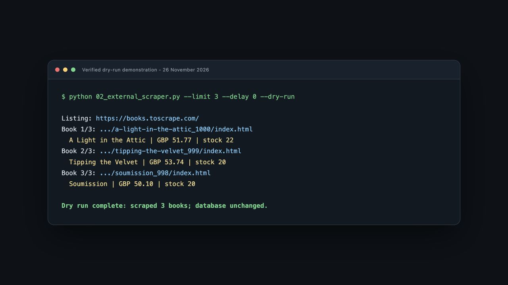

# Books to Scrape - Supabase collector

A command-line Python project that collects book data from [Books to Scrape](https://books.toscrape.com/), stores it in Supabase Postgres, and presents results through the terminal and Supabase's SQL/Table Editor.



## Purpose

The project demonstrates a complete data workflow: collect HTML pages, parse structured book fields, validate and transform them, persist records in a relational database, and inspect the result through a simple interface. The deliberately small design keeps the collection and database decisions easy to explain.

## Data collection

`02_external_scraper.py` requests listing and product pages from `https://books.toscrape.com/`. The site is an educational scraping sandbox; no private or user-specific data is collected.

For each selected book, the parser obtains:

- UPC
- title
- price including tax, converted to integer pence
- stock count
- one-to-five star rating
- category
- UTC scrape time

The HTTP client restricts requests to the expected HTTPS host, identifies itself with a learning-project user agent, waits between requests, retries temporary failures, and supports a configurable timeout. `--limit` and `--start-page` keep collection controlled.

## Data persistence

`01_setup_supabase.sql` creates `public.books` with a numeric primary key, a unique UPC, validation constraints, timestamps, and indexes for name and category. The script enables row-level security and revokes Data API access from `anon` and `authenticated` because this project uses a trusted direct PostgreSQL connection instead of a browser client.

Repeated runs perform a parameterized `INSERT ... ON CONFLICT` upsert by UPC. Existing rows are updated, `first_scraped_at` is preserved, and `last_scraped_at` records the latest collection. The batch runs in one database transaction. An optional JSON preview can also be written locally; `books.json` is ignored by Git.

## User interaction and presentation

The terminal is the collection interface: the user chooses the limit, starting page, delay, timeout, dry-run mode, and optional JSON output. Progress and parsed book summaries are printed as the scraper runs.

The database result can be viewed in Supabase Table Editor or with the verification query below in SQL Editor. This is the presentation interface for the stored data; a separate public web application is not included.

## Setup, configuration, and run

### Requirements

- Python 3.11 or newer
- A Supabase project only for database-writing runs
- Internet access to Books to Scrape

### 1. Create the table

In the Supabase Dashboard, open **SQL Editor**, paste the complete contents of `01_setup_supabase.sql`, and select **Run**. The setup is idempotent and does not delete existing books.

### 2. Install pinned dependencies

```bash
python3 -m venv .venv
source .venv/bin/activate
python -m pip install -r requirements.txt
```

On Windows PowerShell, activate with:

```powershell
.\.venv\Scripts\Activate.ps1
```

### 3. Verify collection without a database

```bash
python 02_external_scraper.py --limit 5 --dry-run
```

To save the same preview as JSON:

```bash
python 02_external_scraper.py --limit 5 --dry-run --json-output books.json
```

### 4. Configure Supabase safely

Open **Connect** in the Supabase Dashboard and copy the Session pooler values. Set them only in the local shell or a secret manager; do not commit a real host, project reference, password, or connection string.

```bash
export SUPABASE_DB_HOST="aws-0-REGION.pooler.supabase.com"
export SUPABASE_DB_PORT="5432"
export SUPABASE_DB_NAME="postgres"
export SUPABASE_DB_USER="postgres.PROJECT_REF"
```

The host and user variables are required. Port defaults to `5432` and database name defaults to `postgres`. A correctly encoded `SUPABASE_DB_URL` may be used instead for advanced setups.

### 5. Collect and store books

```bash
python 02_external_scraper.py --limit 5
```

The script prompts for the database password with hidden input and does not save it. For automation, supply `SUPABASE_DB_PASSWORD` through the runner's secret settings.

For a later batch:

```bash
python 02_external_scraper.py --limit 20 --start-page 6
```

### 6. View the stored data

```sql
select
    id,
    name,
    price_pence / 100.0 as price_gbp,
    stock_count,
    rating,
    category,
    last_scraped_at
from public.books
order by last_scraped_at desc, name;
```

## Tests

```bash
python -m unittest discover -s tests -v
```

The tests use saved HTML fixtures and a mocked database connection, so they do not scrape the live site or modify Supabase.

## Project structure

| File | Purpose |
| --- | --- |
| `01_setup_supabase.sql` | Idempotent table, constraints, indexes, RLS, and grants |
| `02_external_scraper.py` | CLI, HTTP collection, HTML parsing, validation, JSON preview, and database upsert |
| `requirements.txt` | Pinned Python dependencies |
| `tests/test_external_scraper.py` | Parser, configuration, and parameterized-upsert tests |

## Learning, challenge, and solution

The main challenge visible in the implementation is turning inconsistent page text into database-safe values while keeping repeated collections reliable. The solution separates listing parsing from product parsing, converts prices to integer pence, extracts stock with a regular expression, validates required fields, and uses the stable UPC as an atomic upsert key. The project also demonstrates why secrets should be supplied separately from code and why direct database access, Data API permissions, and RLS are different security layers.

This is an evidence-based summary of the implementation. The student should be prepared to explain these decisions in their own words and personalize the reflection if their own learning emphasis was different.

## Limitations

- HTML selectors depend on the current Books to Scrape page structure.
- A live run requires network access; a database-writing run also requires a configured Supabase project.
- The project presents results through a CLI and Supabase's interface rather than a custom GUI.
- The default connection uses the Supabase pooler account supplied by the project owner. A production system should use a dedicated least-privilege database role.
- Tests mock the database. This repository review verified the live dry-run, but did not write to the user's Supabase project because no password was requested or handled.
- The scraper processes at most 1,000 books per invocation and does not schedule itself.

## Assistance, tools, and external code

This project was created and reviewed with assistance from ChatGPT/Codex for planning, code generation and refinement, test creation, documentation, and repository review. External packages are Beautiful Soup, Requests, Psycopg, and their transitive dependencies, all installed from the pinned `requirements.txt`. Data comes from Books to Scrape and persistence uses Supabase/PostgreSQL. The implementation follows the documented interfaces of those projects; no credentials are included.

Built for the Applied Programming & AI Fundamentals course.
